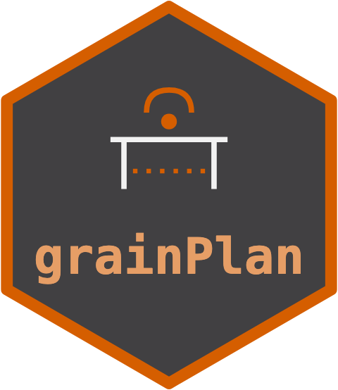

---
output:
  github_document:
    md_extensions: -smart
---

<!-- README.md is generated from README.Rmd. Please edit that file. -->

```{r, include = FALSE}
knitr::opts_chunk$set(
  collapse = TRUE,
  comment = "#>",
  fig.path = "man/figures/README-",
  out.width = "100%"
)
```

# grainPlan 

<!-- badges: start -->
[](https://github.com/max578/grainPlan/actions/workflows/R-CMD-check.yaml)
[](https://app.codecov.io/gh/max578/grainPlan)
[](https://max578.r-universe.dev/grainPlan)
[](https://lifecycle.r-lib.org/articles/stages.html#experimental)
[](https://max578.github.io/grainPlan/)
<!-- badges: end -->

grainPlan is the grain-specific decision orchestrator of the ORCHESTRA
agricultural analytics stack -- the practitioner last-mile that turns an
upstream member's inference result into an actionable grain-production plan.

It is a thin grain-semantics layer on top of
[decideR](https://github.com/max578/decideR): it reuses decideR's decision
engine, its manifest-native pipeline tail, its grade-band loss library, and its
grounding firewall, and adds the grain economics those decisions kept
re-deriving. grainPlan never reinvents decision theory, manifest reading, or the
Independent Oracle Principle firewall; it composes them with grain meaning.

## What it gives you

* **Grain decision verbs** -- `plan_nitrogen_rate()` (a profit-priced nitrogen
  rate), `plan_variety()` (a downside-aware variety ranking from a
  multi-environment trial or a genomic posterior), and `plan_grade_target()` (a
  quality-band decision against a delivery standard). Each returns a
  `grain_decision`.
* **A grain value / loss library** -- `wheat_protein_bands()`,
  `barley_malting_premium()`, and `n_rate_economics()`: the economic schedules
  the orchestra runs kept hand-building, consolidated into reusable, documented
  primitives built from published grade conventions.
* **A season orchestrator** -- `plan_season()` composes several grain decisions
  into one `grain_plan`, combining their grounding worst-case so a plan resting
  on any unverified input abstains as a whole.

## Related packages

- [decisionSupport](https://CRAN.R-project.org/package=decisionSupport)
  chooses between two alternatives by expected welfare from Monte Carlo
  simulations, and values the information that would reduce the
  uncertainty.
- [metan](https://CRAN.R-project.org/package=metan) analyses
  multi-environment trials, with stability measures such as AMMI, GGE
  biplots and joint regression.
- [nlraa](https://CRAN.R-project.org/package=nlraa) fits nonlinear
  response curves used in agricultural research, including
  linear-plateau and quadratic-plateau forms.

grainPlan starts where these leave off. It takes draws from a fitted model,
such as yield at each nitrogen rate or variety merit across trials, and
prices them with grain prices, protein bands and malting premiums to give a
recommendation. When the evidence is marked unverified, it declines and
keeps the status quo instead of recommending.

## Installation

```r
# decideR is grainPlan's base; install it first (it is not on CRAN).
# install.packages("remotes")
remotes::install_github("max578/decideR")
remotes::install_github("max578/grainPlan")
```

## The firewall, in one example

A nitrogen-rate decision on grounded yield evidence decides; the same decision
on unverified evidence abstains to the status quo. This is the inherited
Independent Oracle Principle firewall -- a grain decision is never minted on a
fact the upstream producer did not ground.

```{r firewall}
library(grainPlan)

set.seed(1L)
rates <- seq(0, 200, by = 25)
mu    <- 3 + 2.5 * (1 - exp(-rates / 80))               # diminishing returns
yld   <- vapply(mu, function(m) rnorm(1500L, m, 0.3), numeric(1500L))

# grounded evidence -> a decision
plan_nitrogen_rate(yld, rates, price_grain = 350, price_n = 1.3,
                   crop = "wheat",
                   grounding = decideR::grounding_grounded())

# the SAME draws, unverified -> abstain to the status quo
plan_nitrogen_rate(yld, rates, price_grain = 350, price_n = 1.3,
                   crop = "wheat",
                   grounding = decideR::grounding_unverified())
```

## The orchestra

grainPlan is a member of the ORCHESTRA federation: it consumes the
`orchestra_manifest` contract through decideR's duck-typed tail and depends only
on decideR (the orchestra DAG stays acyclic, with grainPlan a leaf at the
decision tail). See `CONSTELLATION_MEMBER.md` for the full roster.

## API stability

grainPlan is a small but consequential API: the meaning of a recommendation, an
abstention, and a grounding token can drive a paddock decision. While the
package is on a `0.x` series it follows a conservative stability rule.

* Grounding-token semantics, abstention semantics, and the public return classes
  (`grain_decision`, `grain_plan`) do not change silently.
* New capabilities are added in a backward-compatible way where possible; new
  fields may appear on the result objects and their `context` / `metadata`.
* A behaviour change that could alter a recommendation is called out in
  `NEWS.md` (as the v0.1.1 point-GEBV uncertainty change was).
* A function or argument slated for removal gets at least one release carrying a
  deprecation warning first.

## Contributing

Bug reports and suggestions are welcome through the
[issue tracker](https://github.com/max578/grainPlan/issues).

## Citation

```r
citation("grainPlan")
```

## Licence

MIT (c) 2026 Max Moldovan.
